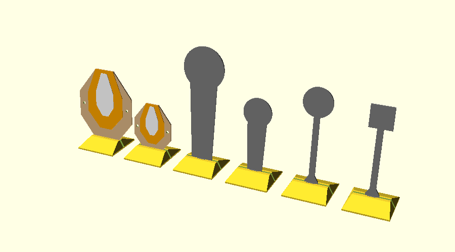

# ipsc-minis

Scaled, 3D-printable targets for dry-fire and airsoft practice, following the
IPSC handgun target dimensions: paper targets plus steel (Poppers, Mini Poppers
and metal plates). One OpenSCAD file, with the scale as a parameter.



## Why scale?

A target that is 1:N in size, placed at distance *d*, looks the same to your
eye as the full-size target at *N × d*. You can practise target acquisition
and transitions at realistic angular sizes in a small room.

| Scale | Target size | At 2 m it looks like | At 3 m | At 6 m |
|---|---|---|---|---|
| 1:4 | 112.5 × 142.5 mm | 8 m | 12 m | 24 m |
| 1:5 | 90 × 114 mm | 10 m | 15 m | 30 m |
| 1:6 | 75 × 95 mm | 12 m | 18 m | 36 m |

Scale the spacing between targets by the same factor. Two targets 1 m apart
at 1:5 should stand 20 cm apart.

Note: only the angular size matches. Your eye still focuses at the real
distance.

## Usage

**Download:** ready-made STLs for 1:4, 1:5 and 1:6 (targets, steel and stands) are
attached to each [release](https://github.com/AlexanderBrevig/ipsc-minis/releases),
built from the `.scad` of that version.

**Build yourself:** open `targets.scad` in OpenSCAD and use the Customizer, or
render from the command line:

```sh
openscad -D scale_n=5 -o target_1-5.stl targets.scad
openscad -D scale_n=5 -D 'part="stand"' -o stand_1-5.stl targets.scad
openscad -D scale_n=5 -D 'part="popper"' -o popper_1-5.stl targets.scad
openscad -D scale_n=5 -D 'part="stand"' -D 'stand_for="popper"' -o popper_stand_1-5.stl targets.scad
```

With Nix:

```sh
nix develop               # shell with OpenSCAD
nix run .#render          # all scales → stl/ + preview.png
nix run .#render -- 4 8   # chosen scales
```

### Parameters

| Parameter | Default | Meaning |
|---|---|---|
| `scale_n` | 5 | Scale denominator (4 = 1:4) |
| `part` | `target` | `target`, `mini` (IPSC Mini Target), `popper`, `mini_popper`, `round_plate`, `square_plate`, `stand`, `plate` (target + stand on one bed), `assembly` (preview only) |
| `round_plate_cm` | 20 | Round metal plate diameter, real-world cm (IPSC: 20–30) |
| `square_plate_cm` | 15 | Square metal plate side, real-world cm (IPSC: 15–30) |
| `plate_stake_cm` | 50 | Height of the metal plate above the ground, real-world cm (see Accuracy) |
| `stake_w` | 8 | Width of the metal plate's stake, mm (not scaled) |
| `thickness` | 2.0 | Plate thickness, mm (not scaled) |
| `zone_style` | `raised` | `raised`: C and A zones stepped up for colour changes. `groove`: zone lines cut into the face |
| `step_h` | 0.6 | Height of each raised step, mm |
| `groove_w`, `groove_d` | 1.2, 0.8 | Groove width and depth, mm |
| `hang_hole` | 4 | Diameter of the two hanging holes in the side D zones (0 = none) |
| `slot_clearance` | 0.3 | Gap on each side of the plate in the stand slot, mm |
| `key_top`, `key_bottom` | 12, 6 | Width of the index key at the top and bottom, mm |
| `key_t` | 1.5 | How far the key stands out from the face, mm |
| `key_clearance` | 0.05 | Gap on each side of the key when fully seated, mm (0 = friction fit) |
| `stand_for` | `all` | Size of the stand: `all` fits every part at that scale, or name one part for a smaller foot |
| `stand_tilt` | 5 | Lean the target back this many degrees (0 = upright) |

One stand fits every part. The part drops into a slot in the stand, and a
small tapered key on the bottom centre of its face drops into a matching
notch in the front wall of the slot. The key is narrow at the bottom and
full width at the top, so it enters loosely and gets tighter as it seats;
friction holds it, and it keeps the part centred. The metal plate stakes
widen near the bottom to carry the key. The stand is sized for the tallest
part at each scale (`stand_1-5.stl` and so on).

### Steel sizes

| Part | Real size | 1:4 | 1:5 | 1:6 |
|---|---|---|---|---|
| Popper | 30 × 85 cm | 75 × 212.5 mm | 60 × 170 mm | 50 × 142 mm |
| Mini Popper | 20 × 56 cm | 50 × 140 mm | 40 × 112 mm | 33 × 93 mm |
| Round plate (20 cm, on a 50 cm stake) | 20 × 70 cm | 50 × 175 mm | 40 × 140 mm | 33 × 117 mm |
| Square plate (15 cm, on a 50 cm stake) | 15 × 65 cm | 37.5 × 162.5 mm | 30 × 130 mm | 25 × 108 mm |

## Printing

- Print flat, no supports.
- **PETG** is recommended. PLA works for dry fire but is brittle if hit.
- For `zone_style = "raised"`, change filament at **Z = 2.0 mm** (C zone) and
  **Z = 2.6 mm** (A zone). The heights are echoed to the OpenSCAD console and
  shift if you change `thickness` or `step_h`. A light A zone on a dark
  target is easy to find.
- Steel is one colour, as in the rules (the whole front painted one colour,
  preferably white), so it has no zones and no colour change.
- The index key sits on the top face, so every part still prints flat
  without supports.
- Print a 1:6 target and stand first to check the fit. If the key stops
  high, raise `key_clearance`; if the part is loose when seated, lower it
  (0 or slightly negative gives a press fit). If the plate binds in the slot,
  raise `slot_clearance`.

## Airsoft

The targets are mainly for dry fire. If you shoot BBs at them:

- Wear eye protection, and so should everyone in the room. A stiff plate
  bounces BBs back.
- Hang the target by its side holes in front of a curtain or a box with a
  towel. A swinging target takes energy out of the BB and shows the hit.
- Use PETG, 3 mm, 100 % infill for more durability.

## Accuracy

- Outer shape, C zone and A zone follow the dimensions on the IPSC target
  diagram. The upper side corners of the A zone are not dimensioned there and
  were read off the drawing.
- The Mini Target is the full target scaled to 30 cm wide (2/3), as in the
  rulebook.
- Popper and Mini Popper follow the IPSC popper diagram: height, head radius,
  base width and the width where the straight body meets the head (20 cm and
  13.5 cm).
- Metal plates use the IPSC handgun size range. **Plate height is not to
  scale by default:** the rules mount plates on stakes at least 1 m high; the
  default 50 cm keeps the print short and stiff. Set `plate_stake_cm = 100`
  for the full height. The stake width is in mm and not scaled.
- The scaled steel does not fall when hit. It is for dry fire and target
  transitions, not for checking calibration.

## Disclaimer

Not affiliated with or endorsed by IPSC (International Practical Shooting
Confederation). "IPSC" is used only to describe the target dimensions these
models follow.

## Licence

Code (`targets.scad`, scripts) under the [MIT licence](LICENSE).
Models (STLs, renders) under [CC BY 4.0](https://creativecommons.org/licenses/by/4.0/).
